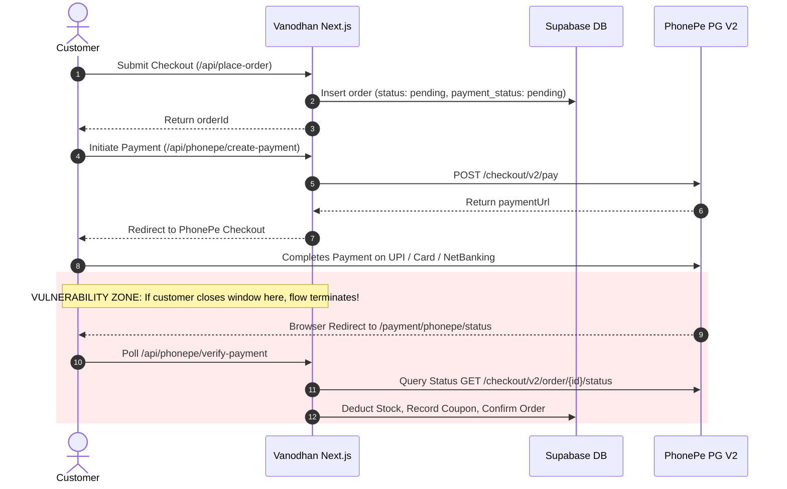
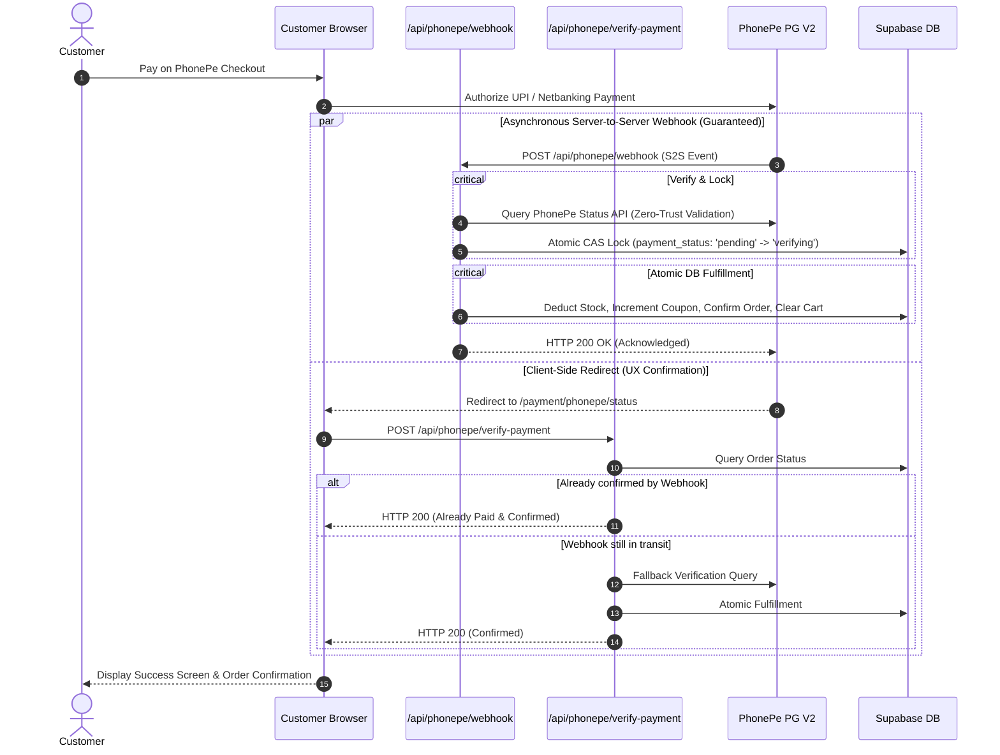

# Vanodhan Herbs — PhonePe Payment Webhook Architecture & Implementation Plan

**Author:** Antigravity AI  
**Scope:** `vanodhan-herbs` (Customer Storefront) & Supabase Database  
**Gateway Integration:** PhonePe Payment Gateway (PG V2 — Sandbox & Production)  
**Status:** Architectural Specification & Implementation Plan  
**Target File for Webhook Route:** `src/app/api/phonepe/webhook/route.js`

---

## 1. Executive Summary & Problem Definition

### 1.1 The Critical Problem
Currently, Vanodhan Herbs verifies PhonePe payments **exclusively on the client side** via the redirect return flow:
```text
User checks out -> PhonePe Payment Page -> User pays -> PhonePe redirects browser to /payment/phonepe/status -> Client polls /api/phonepe/verify-payment
```

While functional during normal testing, this pattern has a fatal flaw in production e-commerce: **The Drop-Off Vulnerability**.
If any of the following occur after money is deducted from the customer's bank account:
1. The customer closes the browser tab or mobile app immediately after seeing the UPI success tick.
2. The user's mobile internet connection drops or switches between Wi-Fi and 5G during redirect.
3. The browser crashes, blocks the redirect, or the battery dies.
4. An aggressive browser content-blocker prevents the redirect script from executing.

**Result:** The customer's money is debited, but on Vanodhan Herbs:
- The order remains indefinitely in `status: "pending"` and `payment_status: "pending"`.
- Product inventory (`stock_quantity`) is **never deducted**.
- The coupon redemption is **never recorded**.
- The user's cart is **never cleared**.
- The order is **never fulfilled** and admin sees it as an unpaid/abandoned attempt.

### 1.2 The Solution: Asynchronous Server-to-Server (S2S) Webhooks
A webhook is an automated HTTP callback sent directly from PhonePe's servers to our backend API (`/api/phonepe/webhook`) the moment a transaction resolves. It operates **out-of-band**, independent of the customer's device, browser, or network connection.

---

## 2. End-to-End Walkthrough: Current vs. Target Flow

### 2.1 Current Flow (Vulnerable to Drop-Off)


### 2.2 Target Flow with Dual-Layer S2S Webhook (Resilient & Bulletproof)


---

## 3. Strict Security Guidelines & Threat Mitigations

### Ground Rule: NEVER Trust the Webhook Body Alone
Attackers who discover or brute-force the webhook URL might attempt to send fabricated JSON payloads:
```json
// FAKE PAYLOAD SENT BY ATTACKER
{
    "event": "PAYMENT_SUCCESS",
    "merchantOrderId": "VH-31f4b238-d99c-4822-87ad-b1d5e683f211",
    "amount": 500000,
    "state": "COMPLETED"
}
```
If your server reads `payload.state === "COMPLETED"` and marks the order as paid, **an attacker can acquire free merchandise without spending a single rupee.**

### 3.1 Dual-Layer Verification Strategy
To achieve zero-trust security, every incoming webhook must pass two distinct checkpoints:

1. **Layer 1: Signature / Checksum Validation**:
   - PhonePe sends a verification header (`x-verify` or authorization signature).
   - In PhonePe PG V2:
     - When receiving a Base64-encoded payload: compute `SHA256(base64_payload + client_secret)` or standard PhonePe HMAC-SHA256 checksum and verify it matches the header.
     - If the checksum fails, the request is immediately rejected with HTTP 400.

2. **Layer 2: Mandatory Gateway Server-to-Server Re-Query (The Ultimate Defense)**:
   - **Never rely on the payload to declare payment success.**
   - Extract only the `merchantOrderId` from the webhook notification.
   - Our server immediately calls PhonePe's official status endpoint:
     `GET /checkout/v2/order/{merchantOrderId}/status`
     using our internal, secret `O-Bearer` OAuth token (`PHONEPE_CLIENT_ID` + `PHONEPE_CLIENT_SECRET`).
   - The status returned directly by PhonePe's servers is the **single source of truth**. If an attacker forged the webhook, PhonePe's server will report `PAYMENT_PENDING`, `PAYMENT_ERROR`, or `ORDER_NOT_FOUND`, instantly thwarting the attack.

### 3.2 Security Matrix & Vulnerability Safeguards

| Threat Vector | Attack Scenario | Mitigation Technique |
| :--- | :--- | :--- |
| **Spoofed Webhook** | Hacker POSTs fake success payload to `/api/phonepe/webhook`. | Checksum verification + backend re-queries PhonePe's S2S Status API directly. |
| **Amount Tampering** | Customer alters client request to pay ₹1 for a ₹5,000 order. | The order amount is fetched strictly from Supabase `orders.total`. Check `gateway_amount === order.total * 100`. |
| **Currency Tampering** | Payment processed in a non-INR currency or mock tokens. | Verify `gateway_currency === "INR"` strictly. |
| **Replay Attacks** | Hacker re-submits an old successful webhook payload. | **Strict Idempotency**: If `orders.payment_status === 'paid'`, acknowledge HTTP 200 immediately without re-executing inventory deductions or coupon increments. |
| **Race Conditions** | Webhook and Client-side redirect arrive at the exact same millisecond. | **Atomic Compare-And-Swap (CAS)**: State transition query checks `payment_status = 'pending'`. Only one process can acquire the lock. |
| **Out-of-Order Webhooks** | A delayed `FAILED` or `PENDING` webhook arrives after a `SUCCESS` event. | One-way state machine. Orders with `payment_status = 'paid'` can never transition back to `pending` or `failed`. |
| **Partial Transaction Failures** | Server crashes after setting order to paid, before deducting stock. | PostgreSQL Database RPC (`complete_order_payment`) that runs all mutations in an ACID database transaction. |
| **DDoS / Slowloris on Webhook** | High volume of fake requests tying up server threads. | Validate request size, enforce 5-second fetch timeout, and reject payloads exceeding 32KB. |

---

## 4. Concurrency Control & Race Condition Prevention

### 4.1 The Race Condition Scenario
When a payment succeeds, two requests fire almost simultaneously:
1. **Request A (Webhook)**: PhonePe $\rightarrow$ `/api/phonepe/webhook`
2. **Request B (Client Redirect)**: Browser $\rightarrow$ `/api/phonepe/verify-payment`

If both endpoints read `payment_status: "pending"` before either updates the database:
- Both will execute: `stock_quantity = stock_quantity - item.quantity` $\rightarrow$ **Stock deducted twice!**
- Both will execute: `coupons.used_count = used_count + 1` $\rightarrow$ **Coupon count inflated!**
- Both will insert into `coupon_redemptions` $\rightarrow$ **Duplicate redemption rows!**

### 4.2 The Solution: Atomic Stored Procedure (`complete_order_payment`)
Instead of executing 4 separate queries in Node.js, we execute the entire fulfillment in an atomic PostgreSQL transaction.

```sql
-- PostgreSQL Atomic Fulfillment Procedure
CREATE OR REPLACE FUNCTION public.complete_order_payment(
    p_order_id UUID,
    p_phonepe_order_id TEXT,
    p_transaction_id TEXT,
    p_gateway_response JSONB
)
RETURNS JSONB
LANGUAGE plpgsql
SECURITY DEFINER
SET search_path = public, auth
AS $$
DECLARE
    v_order RECORD;
    v_item RECORD;
    v_coupon RECORD;
BEGIN
    -- 1. Acquire row-level lock on the order
    SELECT * INTO v_order
    FROM public.orders
    WHERE id = p_order_id
    FOR UPDATE;

    IF NOT FOUND THEN
        RETURN jsonb_build_object('success', false, 'code', 'ORDER_NOT_FOUND', 'message', 'Order not found.');
    END IF;

    -- 2. Idempotency Check: If already paid, return success immediately
    IF v_order.payment_status = 'paid' THEN
        RETURN jsonb_build_object('success', true, 'code', 'ALREADY_PAID', 'message', 'Order is already marked as paid.');
    END IF;

    -- 3. Verify order is in a valid state to be paid
    IF v_order.status = 'cancelled' THEN
        RETURN jsonb_build_object('success', false, 'code', 'ORDER_CANCELLED', 'message', 'Cancelled order cannot be marked as paid.');
    END IF;

    -- 4. Deduct Inventory for all items in order
    FOR v_item IN
        SELECT oi.product_id, oi.quantity, p.name, p.stock_quantity
        FROM public.order_items oi
        JOIN public.products p ON p.id = oi.product_id
        WHERE oi.order_id = p_order_id
    LOOP
        IF v_item.stock_quantity < v_item.quantity THEN
            -- In rare edge-cases of overselling during payment delay, log warning
            -- Still honor paid order or trigger backorder alert
        END IF;

        UPDATE public.products
        SET stock_quantity = GREATEST(stock_quantity - v_item.quantity, 0),
            updated_at = NOW()
        WHERE id = v_item.product_id;
    END LOOP;

    -- 5. Record Coupon Redemption (if coupon applied)
    IF v_order.coupon_id IS NOT NULL THEN
        UPDATE public.coupons
        SET used_count = used_count + 1,
            updated_at = NOW()
        WHERE id = v_order.coupon_id;

        INSERT INTO public.coupon_redemptions (coupon_id, user_id, order_id, created_at)
        VALUES (v_order.coupon_id, v_order.user_id, p_order_id, NOW())
        ON CONFLICT DO NOTHING;
    END IF;

    -- 6. Transition Order Status to Paid & Confirmed
    UPDATE public.orders
    SET status = 'confirmed',
        payment_status = 'paid',
        phonepe_order_id = p_phonepe_order_id,
        gateway_transaction_id = p_transaction_id,
        gateway_response = p_gateway_response,
        updated_at = NOW()
    WHERE id = p_order_id;

    -- 7. Clear Customer's Cart
    DELETE FROM public.cart_items
    WHERE user_id = v_order.user_id;

    RETURN jsonb_build_object('success', true, 'code', 'ORDER_CONFIRMED', 'message', 'Order payment completed successfully.');
END;
$$;
```

**Why this is 100% race-condition proof:**
- `SELECT ... FOR UPDATE` locks the order row at the database kernel level.
- Whichever request (Webhook or Client Redirect) hits the database first acquires the lock, changes `payment_status` to `'paid'`, and completes fulfillment.
- The second request waits for the lock. Once acquired, it reads `payment_status = 'paid'`, enters the idempotency check (Step 2), and exits cleanly with `{ success: true, code: 'ALREADY_PAID' }` without touching inventory or coupons!

---

## 5. Audit Logging: `payment_webhook_logs` Table

For financial compliance, security auditing, and debugging test payments, every incoming webhook must be logged immutably.

```sql
CREATE TABLE IF NOT EXISTS public.payment_webhook_logs (
    id UUID PRIMARY KEY DEFAULT gen_random_uuid(),
    provider TEXT NOT NULL DEFAULT 'phonepe',
    event_type TEXT,
    merchant_order_id TEXT,
    order_id UUID REFERENCES public.orders(id) ON DELETE SET NULL,
    headers JSONB,
    payload JSONB NOT NULL,
    verification_status TEXT NOT NULL, -- 'verified', 'checksum_failed', 'amount_mismatch', 'already_processed', 'error'
    error_message TEXT,
    ip_address TEXT,
    created_at TIMESTAMPTZ NOT NULL DEFAULT NOW()
);

-- Index for rapid order lookup during debugging
CREATE INDEX IF NOT EXISTS idx_webhook_logs_order_id ON public.payment_webhook_logs(order_id);
CREATE INDEX IF NOT EXISTS idx_webhook_logs_merchant_order_id ON public.payment_webhook_logs(merchant_order_id);
CREATE INDEX IF NOT EXISTS idx_webhook_logs_created_at ON public.payment_webhook_logs(created_at DESC);
```

---

## 6. PhonePe PG V2 Webhook Specification (Sandbox / Test Mode)

### 6.1 Sandbox Environment Variables
Current configuration in `vanodhan-herbs/.env.local`:
```ini
PHONEPE_CLIENT_ID=M220H7D1AM48J_2606141636
PHONEPE_CLIENT_SECRET=ZjFjYWJmYjgtMGQ5Zi00YzhjLTgwZGUtMDQxNDYzYTI0ZDI1
PHONEPE_CLIENT_VERSION=1
PHONEPE_ENV=sandbox
NEXT_PUBLIC_APP_URL=http://localhost:3000
```
- **PhonePe Sandbox Auth URL:** `https://api-preprod.phonepe.com/apis/pg-sandbox/v1/oauth/token`
- **PhonePe Sandbox Base URL:** `https://api-preprod.phonepe.com/apis/pg-sandbox`

### 6.2 Passing `callbackUrl` in `createPhonePePayment`
In `src/lib/phonepe.js`, when initiating payment via `/checkout/v2/pay`, PhonePe PG V2 accepts `callbackUrl` inside `paymentFlow.merchantUrls`:

```javascript
// Enhancement to src/lib/phonepe.js
merchantUrls: {
    redirectUrl,                              // User browser return
    callbackUrl: `${appUrl}/api/phonepe/webhook` // PhonePe S2S Webhook callback
}
```

### 6.3 PhonePe Webhook Payload Structure
PhonePe sends an HTTP `POST` request with headers and a body. In PhonePe standard integrations:
```json
{
    "response": "eyJzdWNjZXNzIjp0cnVlLCJjb2RlIjoiUEFZTUVOVF9TVUNDRVNTIiwibWVzc2FnZSI6IlBheW1lbnQgc3VjY2Vzc2Z1bCIsImRhdGEiOnsibWVyY2hhbnRJZCI6Ik0yMjBIN0QxQU00OEoiLCJtZXJjaGFudFRyYW5zYWN0aW9uSWQiOiJWSC1lMThkMmY2NSIsImFtb3VudCI6OTk5MDAsInN0YXRlIjoiQ09NUExFVEVEIn19"
}
```
Or raw JSON event notification:
```json
{
    "event": "PAYMENT_SUCCESS",
    "payload": {
        "merchantOrderId": "VH-e18d2f65-24e1-4cfa-a0f5-56d1f9532890",
        "orderId": "OMO26092911050012345678",
        "state": "COMPLETED",
        "amount": 99900
    }
}
```
Our webhook parser will safely handle **both** formats (Base64 decoded and raw JSON object).

---

## 7. Testing Webhooks in Local Test Mode (The Tunnel Setup)

### 7.1 The Localhost Dilemma
In local development, your server runs on `http://localhost:3000`.
PhonePe's test servers (`api-preprod.phonepe.com`) reside on the public internet and **cannot route traffic to your local machine's localhost**.

### 7.2 The Solution: Secure HTTPS Tunnel (ngrok)
To test webhooks in sandbox mode:
1. Open a terminal and run:
   ```bash
   npx ngrok http 3000
   ```
2. ngrok will output a public HTTPS forwarding URL, e.g.:
   `https://abc1-223-185-40-12.ngrok-free.app`
3. Update `NEXT_PUBLIC_APP_URL` in `vanodhan-herbs/.env.local`:
   ```ini
   NEXT_PUBLIC_APP_URL=https://abc1-223-185-40-12.ngrok-free.app
   ```
4. Now, when PhonePe triggers `/api/phonepe/webhook`, the request routes directly from PhonePe Sandbox $\rightarrow$ ngrok $\rightarrow$ your local Next.js server!

### 7.3 Step-by-Step Test Scenarios in Sandbox Mode

| # | Test Scenario | Expected Outcome | Verification |
| :- | :--- | :--- | :--- |
| **T1** | **Drop-Off Test**: Complete payment on PhonePe Sandbox, then immediately close browser tab before redirect. | Webhook receives event, queries PhonePe S2S, confirms order, reduces stock, and clears cart. | Check Supabase `orders` table: `status = 'confirmed'`, `payment_status = 'paid'`. |
| **T2** | **Normal Flow Test**: Complete payment and allow browser to redirect to status page. | Either Webhook or Redirect acquires lock; second one hits `ALREADY_PAID` branch. Stock is deducted exactly once. | Verify `stock_quantity` in `products` is reduced by exactly order quantity, not double. |
| **T3** | **Failed Payment**: Select "Fail" or "Cancel" on PhonePe Sandbox simulator. | Webhook sets `payment_status = 'failed'`. Order remains unconfirmed. Stock is NOT deducted. Cart remains intact. | Check Supabase `orders` table: `payment_status = 'failed'`, `status = 'pending'`. |
| **T4** | **Spoofing Simulation**: Send artificial POST using Postman / curl with fake completed payload. | Webhook calls PhonePe S2S status API; PhonePe rejects or returns mismatch. Database is NOT updated. | Webhook responds 400/404, log created with `verification_status: 'error'`. |
| **T5** | **Idempotent Retry**: Send the identical webhook payload 3 times in a row. | First call processes fulfillment; calls 2 and 3 return HTTP 200 with code `ALREADY_PAID`. | No duplicate redemptions in `coupon_redemptions`. |

---

## 8. Implementation Roadmap (Phase-by-Phase Plan)

> **Important:** As requested, **NO CODE CHANGES** have been executed yet. The following phases represent the systematic roadmap for execution once approved.

### Phase 1: Database Foundation
1. Execute Supabase migration creating the audit table: `public.payment_webhook_logs`.
2. Deploy the atomic PostgreSQL function: `public.complete_order_payment`.
3. Add appropriate indexes on `orders (gateway_order_id)` and `payment_webhook_logs`.

### Phase 2: Shared Order Fulfillment Module (`src/lib/orderFulfillment.js`)
1. Create a centralized, testable fulfillment module used by **both** the webhook route and the client verify route.
2. Encapsulate:
   - Calling the atomic `complete_order_payment` RPC.
   - Fallback error logging and audit record creation.

### Phase 3: Webhook Route Handler (`src/app/api/phonepe/webhook/route.js`)
1. Build the POST handler for `/api/phonepe/webhook`.
2. Implement header/checksum extraction and decoding.
3. Call `checkPhonePeOrderStatus(merchantOrderId)` directly using secret OAuth credentials.
4. Verify amount, currency, and transaction ID against Supabase record.
5. Invoke `complete_order_payment` atomic procedure.
6. Record execution in `payment_webhook_logs`.
7. Return `{ success: true }` with HTTP 200 to PhonePe within 2 seconds.

### Phase 4: Gateway Initiation Update (`src/lib/phonepe.js` & `create-payment`)
1. Update `createPhonePePayment` to pass `callbackUrl: ${appUrl}/api/phonepe/webhook` in `merchantUrls`.
2. Ensure both `redirectUrl` and `callbackUrl` are properly passed to PhonePe.

### Phase 5: Client-Side Refactor (`verify-payment/route.js`)
1. Update `src/app/api/phonepe/verify-payment/route.js` to utilize the same `complete_order_payment` procedure.
2. If the webhook has already confirmed the order, `verify-payment` immediately returns HTTP 200 with `ALREADY_PAID` without redundant calls.

### Phase 6: Sandbox Verification & ngrok Live Testing
1. Spin up ngrok tunnel on port 3000.
2. Run test checkouts using PhonePe Sandbox simulated UPI and Card flows.
3. Validate Scenarios T1 through T5.
4. Document test logs and verify database state integrity.

---

## 9. Conclusion
By decoupling payment confirmation from the user's browser and anchoring it on an authenticated Server-to-Server Webhook backed by an atomic database transaction, Vanodhan Herbs will achieve **100% zero-drop-off payment reliability**, total protection against payment spoofing, and clean, idempotent order fulfillment.
